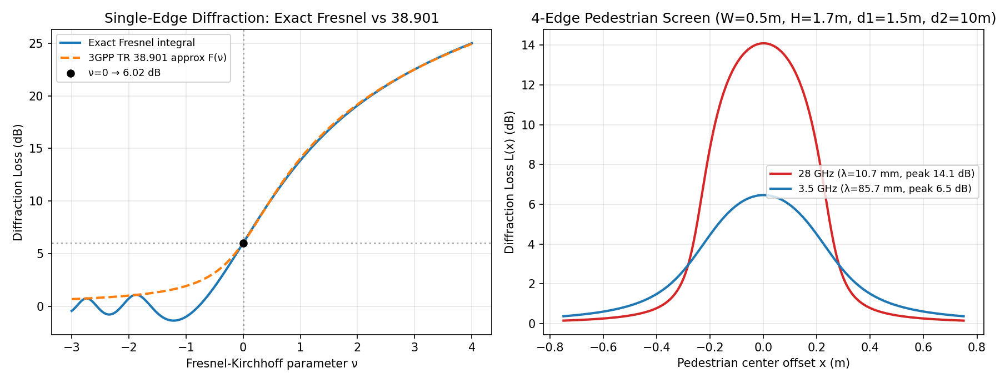
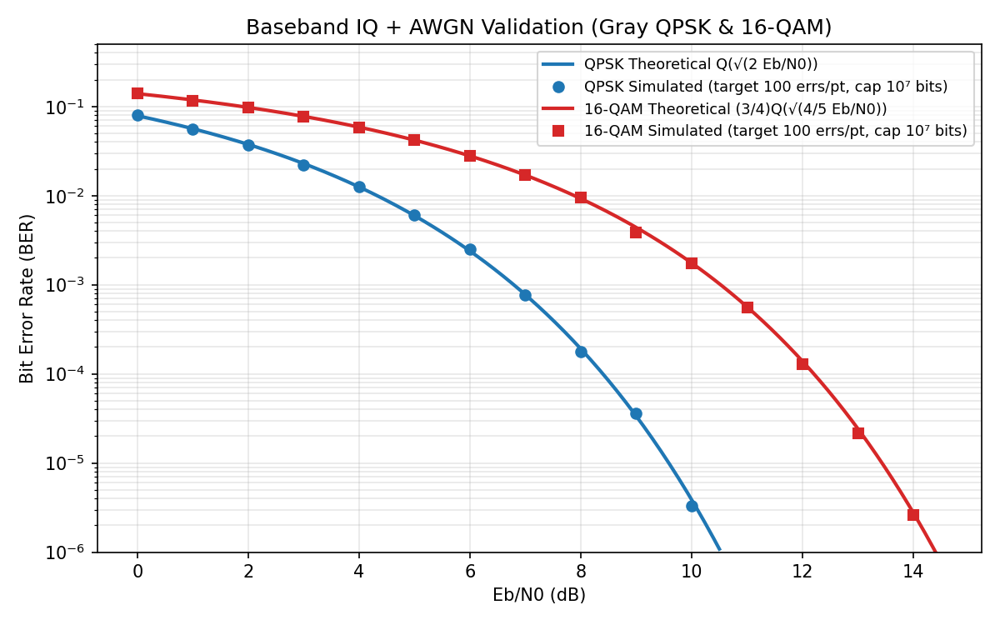
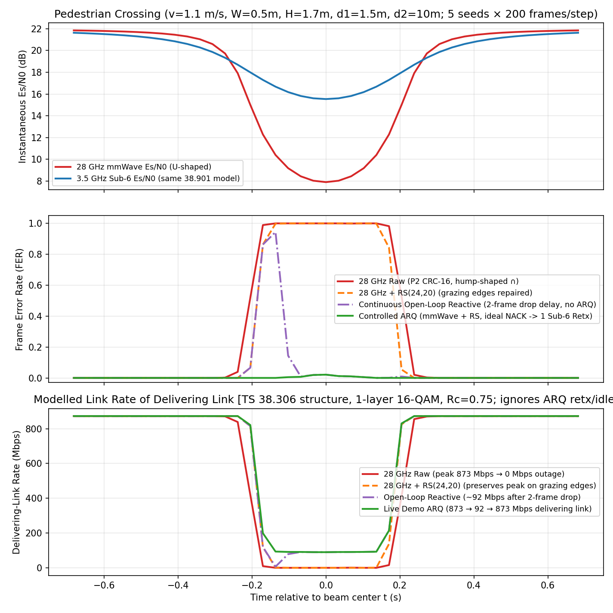

# Physics-to-Bits 5G Channel Error Model & Hybrid Resilience Architecture

A physics-informed application-layer 5G NR channel emulator and three-program stop-and-wait ARQ resilience pipeline integrated with an **Open5GS + UERANSIM** standalone (SA) 5G testbed.

---

## 1. Abstract & Problem Statement

Software 5G testbeds such as **Open5GS + UERANSIM** accurately emulate 3GPP control-plane procedures (NAS, NGAP, PDU session establishment) and user-plane **GTP-U (UDP 2152)** tunneling across isolated UE interfaces (`uesimtun0`). However, they lack an RF physical layer—and in production 5G NR, MAC/RLC CRC and HARQ prevent corrupted physical-layer frames from ever reaching IP.

Common testbed workarounds inject synthetic packet drops using Linux `tc netem` (e.g., `netem loss 20%`). Such flat IP-layer drops are decoupled from carrier frequency, wavelength, blocker geometry, modulation order, and coding limits.

**This project solves that gap** by building an end-to-end **Physics-to-Bits** error injection and hybrid error-resilience pipeline:
1. Every bit flip is derived from **3GPP TR 38.901 Model B 4-edge diffraction**, **unit-energy Gray 16-QAM modulation**, **complex AWGN**, and **maximum-likelihood (ML) Euclidean demapping**.
2. Both **28 GHz mmWave (FR2, $\lambda \approx 10.7\text{ mm}$)** and **3.5 GHz Sub-6 (FR1, $\lambda \approx 85.7\text{ mm}$)** are evaluated through the exact same diffraction function.
3. Grazing-edge corruption ($\le 2$ bytes) is detected mathematically via **CRC-16/XMODEM** and repaired algebraically on 28 GHz using a from-scratch **$\text{GF}(2^8)$ systematic shortened Reed-Solomon `RS(24, 20)`** decoder.
4. Deep center blockage ($> 2$ bytes) exhausts RS, triggers a real **`NACK`** back over the Open5GS UPF, and retransmits the encoded codeword over the **3.5 GHz Sub-6** anchor.

---

## 2. System Architecture

```text
┌──────────────────────────────────────────────────────────────────────────────┐
│                 UE 1 (netns ue1 — uesimtun0: 10.45.0.x)                      │
│  PROGRAM 1 (prog1_tx_channel.py)                                             │
│  • Splits input into <=18 B chunks → CRC-16/XMODEM → Systematic RS(24, 20)   │
│  • Emulates 28 GHz (3GPP 38.901 4-edge + Gray 16-QAM + AWGN + ML demap)      │
│  • Sends ONLY on 28 GHz (:5001) first; times real RTT via perf_counter()     │
│  • Retransmits on 3.5 GHz (:5002, up to 2 retries) ONLY upon NACK (:5004)    │
└────────────────────────────────────┬─────────────────────────────────────────┘
                                     │ Real UDP over Open5GS + UERANSIM
                                     │ ue1:uesimtun0 → nr-ue → nr-gnb →
                                     │ Open5GS UPF (GTP-U 2152) → ue2:uesimtun0
                                     ▼
┌──────────────────────────────────────────────────────────────────────────────┐
│                 UE 2 (netns ue2 — uesimtun0: 10.45.0.y)                      │
│  PROGRAM 2 (prog2_crc_detector.py) — Observability Tap                       │
│  • Strict frame validation (exact length, link_id, flags, RS bounds)         │
│  • Pure polynomial division: (M(x)·x^16 + CRC(x)) mod G(x) == 0x0000         │
│  • Zero cheat flags (header x_m / Es_N0 are display-only telemetry)          │
│  • Forwards untouched raw wire codewords → Program 3 (127.0.0.1:5003)        │
└────────────────────────────────────┬─────────────────────────────────────────┘
                                     ▼
┌──────────────────────────────────────────────────────────────────────────────┐
│                 UE 2 (netns ue2 — 127.0.0.1:5003)                            │
│  PROGRAM 3 (prog3_rs_resilience.py) — RS Decoder & ARQ Controller            │
│  • GF(2^8) Syndromes S_j = r(α^j) → Berlekamp-Massey → Chien → Forney        │
│  • Post-decode CRC-16 integrity gate (catches residual RS miscorrections)    │
│  • Bounded replay cache (OrderedDict, cap 4096) for duplicate suppression    │
│  • Clean / <=2 B repaired → delivers & sends ACK (:5004) over UPF to UE 1    │
│  • >2 B corrupted → drops mmWave frame & sends NACK (:5004) → Sub-6 rescue   │
└──────────────────────────────────────────────────────────────────────────────┘
```

### Repository Structure

| File | Role |
| :--- | :--- |
| `core.py` | Consolidated core library: 6 blocker scenarios, exact Fresnel & 3GPP TR 38.901 Model B 4-edge diffraction, unit-energy Gray QPSK/16-QAM + AWGN, pure CRC-16/XMODEM, from-scratch `GF(2^8)` RS encoder/decoder, strict binary framing, and `os.setns`/`uesimtun0` helpers. |
| `prog1_tx_channel.py` | **Program 1 (`netns ue1`)**: Interactive chunked TX, physics channel emulator, stop-and-wait ARQ client, and `perf_counter` RTT measurement. |
| `prog2_crc_detector.py` | **Program 2 (`netns ue2`)**: Pure mathematical CRC-16 detector and raw-packet forwarder. |
| `prog3_rs_resilience.py` | **Program 3 (`netns ue2`)**: `GF(2^8)` RS syndrome decoder, post-decode CRC gate, duplicate suppression, and Sub-6 ARQ controller. |
| `validate_physics_to_bits.py` | Reproducible Examiner Defense validation suite generating all verification metrics and plots. |
| `start_5g_stack.sh`, `setup_namespaces.sh`, `verify_link.sh` | Open5GS + UERANSIM namespace setup, stack startup, and GTP-U UDP 2152 path verification. |
| `run_physics_demo.sh` | Launcher for live Open5GS (`sudo ./run_physics_demo.sh`) or offline smoke testing (`--loopback-test`). |
| `plots/` | Generated PNG validation figures (`diffraction_validation.png`, `ber_validation.png`, `crossing_resilience.png`). |
| `Physics_to_Bits_5G_Error_Model.pptx` | 10-slide presentation summarizing design, validation, and results (generated by `build_presentation.py`). |

---

## 3. Detailed Design & Mathematical Formulation

### 3.1 Five-Link Physics-to-Bits Channel (`core.py`)

1. **Blocker Kinematics & Geometry:**
   A blocker screen of width $W$ (from scenario profiles: `0.5 m` pedestrian in `urban_high` up to `2.4 m` truck in `rural_low`) and height $H = 1.7\text{ m}$ sits at Fresnel distances $d_1 = 1.5\text{ m}$ (TX to blocker) and $d_2 = 10.0\text{ m}$ (blocker to RX), with straight-line path $r = d_1 + d_2$ and ray height $z_{\text{ray}} = 1.2\text{ m}$.
2. **3GPP TR 38.901 Model B (4-Edge Rectangular Screen Diffraction):**
   For each of the four screen edges ($h_1, h_2, v_1, v_2$) with excess path length $\Delta d = D_1 + D_2 - r$:
   $$F = \frac{1}{\pi}\arctan\!\left(\pm\frac{\pi}{2}\sqrt{\frac{\pi}{\lambda}(D_1 + D_2 - r)}\right), \qquad L_{\text{dB}} = -20\log_{10}\!\Big(1 - (F_{h1} + F_{h2})(F_{v1} + F_{v2})\Big)$$
   where $+$ denotes the shadow side and $-$ the lit side. Both 28 GHz ($\lambda = 10.7\text{ mm}$) and 3.5 GHz ($\lambda = 85.7\text{ mm}$) call the exact same function.
3. **Instantaneous SNR Collapse:**
   $$\left(\frac{E_s}{N_0}\right)(x) = \left(\frac{E_s}{N_0}\right)_{\text{LoS}} - L_{\text{dB}}(x), \qquad \left(\frac{E_s}{N_0}\right)_{\text{LoS}} = 22.0\text{ dB}$$
   For uncoded 16-QAM ($4\text{ bits/symbol}$), $E_s/N_0 = E_b/N_0 + 6.02\text{ dB}$.
4. **Nibble-Aligned Unit-Energy Gray 16-QAM + Complex AWGN:**
   Each byte splits into two 4-bit nibbles (so one 16-QAM symbol error affects at most one RS byte). Gray PAM-4 levels $\{-3, -1, +1, +3\}$ per axis are scaled by $1/\sqrt{10}$ so average symbol energy $E_s = 1$. Complex AWGN adds independent zero-mean Gaussian noise per axis with variance $\sigma^2 = N_0 / 2$ ($\sigma = \sqrt{N_0 / 2}$).
5. **ML Minimum-Euclidean-Distance Demapping:**
   Independent I/Q slicing at $\{-2, 0, +2\}/\sqrt{10}$ (exact 2D ML demapping on a rectangular constellation) produces natural single-bit flips at grazing SNR and heavy corruption at dead center.

### 3.2 Coding, Framing & ARQ Protocol (`core.py`, `prog1`–`prog3`)

- **18-Byte Chunking:** For codeword length $N$ and byte error probability $p_B$, RS($t=2$) succeeds with binomial probability $\sum_{k=0}^{2}\binom{N}{k}p_B^k(1-p_B)^{N-k}$. Limiting payload blocks to $\le 18\text{ B}$ (`RS(24, 20)`) maintains ~90% grazing-edge recovery (compared to ~13% for 100-byte blocks).
- **CRC-16/XMODEM:** Generator $G(x) = x^{16} + x^{12} + x^5 + 1$ (`0x1021`), `init = 0x0000`, no reflection, no final XOR. Receiver verifies $(M(x)x^{16} + \text{CRC}(x)) \bmod G(x) == \text{0x0000}$.
- **Systematic Shortened `RS(24, 20)` over $\text{GF}(2^8)$:** Built from scratch using primitive polynomial $x^8 + x^4 + x^3 + x^2 + 1$ (`0x11D`, $\alpha = 2$). Decoder computes syndromes $S_j = r(\alpha^j)$, runs **Berlekamp-Massey**, enforces shortened-block root bounds $[0, N-1]$ in **Chien search**, solves error magnitudes via **Forney's algorithm**, re-verifies zero syndromes, and gates delivery with **post-decode CRC-16**.
- **Defensive Framing & Bounded ARQ:** `unpack_frame()` enforces exact datagram length `HEADER_SIZE + cw_len`, valid `link_id`, known `flags`, and valid `rs_nsym`/`cw_len`. Program 1 implements stop-and-wait ARQ (1 mmWave retry on ACK timeout; up to `--max-sub6-retries 2` on Sub-6 after NACK). Program 3 maintains a bounded `OrderedDict` replay window (`MAX_REPLAY_WINDOW = 4096`) to suppress duplicate deliveries and re-send ACKs.
- **Modelled Delivering-Link Peak Rate (TS 38.306 Structure):** Using single-layer 16-QAM, net payload ratio $R_c = 18/24 = 0.75$, and TS 38.104 RB tables (`264 / 132 / 66 / 32` RBs at 120 kHz SCS for FR2 `400 / 200 / 100 / 50 MHz`; `106` RBs at 30 kHz SCS for FR1 `40 MHz`): **`872.8 / 436.4 / 218.2 / 105.8 Mbps`** (28 GHz) vs. **`91.9 Mbps`** (3.5 GHz).

---

## 4. How to Run

### Live Over Open5GS + UERANSIM (3 Terminals)
```bash
# 1. Start Open5GS + UERANSIM namespaces and verify GTP-U (UDP 2152)
sudo ./start_5g_stack.sh
sudo ./verify_link.sh

# 2. Launch in 3 side-by-side terminals (start P3 -> P2 -> P1)
sudo ./prog3_rs_resilience.py
sudo ./prog2_crc_detector.py
sudo ./prog1_tx_channel.py
```
At the Program 1 prompt, use `clear`, `edge`, `center`, `x=<m>`, `scenarios`, or any scenario name (`urban_high` .. `rural_low`), type any message to transmit, and `quit` to exit.

### Offline Verification (No `sudo` Required)
```bash
./run_physics_demo.sh --loopback-test
python3 validate_physics_to_bits.py
```

---

## 5. Experimental Results & Validation

### 5.1 Coding & Adversarial Input Validation
- **CRC-16/XMODEM:** Exhaustively verified across **every starting bit position** for all burst lengths $1 \dots 16$ bits.
- **RS(24, 20) Repair:** `400 / 400` random 1-byte and 2-byte error patterns repaired exactly; parity-only flips verified (`P2 PASS` while `P3` detects non-zero syndromes and repairs parity).
- **Shortened-RS Miscorrection (10,000 5-byte error trials):** `37 / 10,000` (`0.37%`, matching shortened-RS theory $\approx \frac{1}{2!}(24/256)^2 = 0.44\%$), with **`0 / 10,000`** escaping the post-decode CRC-16 gate (analytical conditional escape bound $\approx 2^{-16} \approx 1.5 \times 10^{-5}$).
- **Adversarial Input Rejection:** 0/1/2/6-byte truncated frames, trailing bytes, invalid `link_id`/flags/feedback codes, `nsym` $\in \{0, 1, 3, -2\}$, and empty RS/CRC buffers are all strictly rejected.

### 5.2 Diffraction Physics Validation

- Exact single-edge Fresnel at $\nu = 0$: **`6.0206 dB`**.
- Max `|Exact Fresnel − 3GPP 38.901|`: **`0.19 dB`** on the shadow side ($\nu \in [0, 4]$); **`3.03 dB`** on the lit side ($\nu = -1.14$, expected because 38.901's monotonic `arctan` smooths out lit-side Fresnel ripples).
- 4-edge asymptotic checks: $W, H \to 1000\text{ m}$ (grazing 1 edge) = **`6.0095 dB`**; finite screen $\lambda \to 300\text{ m}$ = **`0.0071 dB`**.
- Default center blockage (`W = 0.5 m`, `H = 1.7 m`, `d1 = 1.5 m`, `d2 = 10 m`): **`14.09 dB`** at 28 GHz vs. **`6.46 dB`** at 3.5 GHz.

### 5.3 Baseband BER Validation

- Target 100 bit errors per $E_b/N_0$ point, capped at $10^7$ bits (`QPSK 10 dB`: `33 / 10^7`; `16-QAM 14 dB`: `26 / 10^7`).
- Empirical Gray QPSK (`0–10 dB`) and Gray 16-QAM (`0–14 dB`) match textbook $Q(\sqrt{2 E_b/N_0})$ and $\frac{3}{4}Q(\sqrt{\frac{4}{5} E_b/N_0})$ curves down to $2.6 \times 10^{-6}$.

### 5.4 Multi-Seed Continuous Crossing Sweep (41,000 Frames)


Evaluated across **5 independent seeds (`42–46`) $\times$ 200 continuous 41-step trajectories = 41,000 frames** (`urban_high`, ideal feedback):

| Scheme | Controlled-Sim FER | Failed / Total | 95% Wilson CI | Per-Seed Range | Modelled Delivering-Link Rate |
| :--- | :---: | :---: | :---: | :---: | :---: |
| **Raw 28 GHz** | `29.47%` | `12,081 / 41,000` | `[29.03%, 29.91%]` | `29.40%–29.55%` | `615.7 Mbps` |
| **28 GHz + RS(24, 20)** | `26.40%` | `10,823 / 41,000` | `[25.97%, 26.83%]` | `26.34%–26.51%` | `642.4 Mbps` |
| **Continuous Open-Loop (2-frame drop)** | `5.13%` | `2,103 / 41,000` | `[4.92%, 5.35%]` | `5.09%–5.22%` | `662.0 Mbps` |
| **Controlled ARQ (1 Sub-6 Retx)** | **`0.19%`** | **`79 / 41,000`** | **`[0.15%, 0.24%]`** | **`0.17%–0.27%`** | **`666.5 Mbps`** |

### 5.5 Live Open5GS Edge-Case Observation (`rural_low`)
Behind a `2.4 m` highway truck at dead center (`rural_low`), 28 GHz loses **`21.20 dB`** ($E_s/N_0 = +0.80\text{ dB}$) and 3.5 GHz loses **`12.66 dB`** ($E_s/N_0 = +9.34\text{ dB}$, $E_b/N_0 = +3.32\text{ dB} \to \sim 7\%$ BER). Fixed 16-QAM + RS($t=2$) fails on **both** bands, directly demonstrating the boundary where real 5G NR requires Adaptive Modulation and Coding (AMC).

---

## 6. Explicit Assumptions & Scope Boundaries

- **Application-layer payload channel:** Transport headers (`16 B`) and `ACK`/`NACK` control frames (`7 B`) sit outside the simulated AWGN channel; Test 4 models ideal feedback and 1 Sub-6 retry.
- **Fixed MCS & no small-scale fading:** Fixed 16-QAM + shortened RS is chosen for algebraic inspectability, and multipath fading/Doppler are omitted to isolate deterministic diffraction loss. Real 5G NR employs LDPC + AMC and RRC RSRP triggers (`A2/A3/B1`) for NR-DC.
- **Link-budget & geometry assumptions:** Equal `22 dB` LoS $E_s/N_0$ assumes mmWave beamforming gain compensates for its `+18.1 dB` higher FSPL and `+10.0 dB` wider-bandwidth thermal noise floor (`-81.0` vs. `-91.0 dBm` at `NF = 7 dB`). Blocker height (`H = 1.7 m`) and Fresnel distances (`d1 = 1.5 m, d2 = 10.0 m`) are held fixed across scenarios.
- **Modelled vs. measured metrics:** `872.8 / 91.9 Mbps` are modelled PHY delivering-link rates (ignoring ARQ idle/retransmission airtime), not Python UDP socket throughput; real network transit latency is measured directly via `time.perf_counter()` RTT in Program 1.

---

## 7. Conclusion & Future Work

This project demonstrates a mathematically verified, end-to-end **Physics-to-Bits** 5G channel and error-resilience pipeline over a live Open5GS + UERANSIM user plane. Algebraic shortened Reed-Solomon coding repairs grazing-edge single- and double-byte errors directly on the high-bandwidth 28 GHz carrier, while reactive stop-and-wait ARQ fallback to the 3.5 GHz Sub-6 anchor reduces controlled crossing FER from **`29.47%`** to **`0.19%`** across 41,000 continuous-trajectory frames.

**Future extensions:**
- Integrating **Adaptive Modulation and Coding (AMC)** (QPSK + low-rate LDPC) to survive deep truck/building shadows where fixed 16-QAM fails on both bands.
- Adding **Rician/Rayleigh small-scale fading** and **RRC RSRP measurement triggers** (`A2/A3/B1`) for proactive dual-connectivity switching.
- Subjecting feedback and transport headers to channel impairments for full-packet PHY-to-application reliability modelling.
